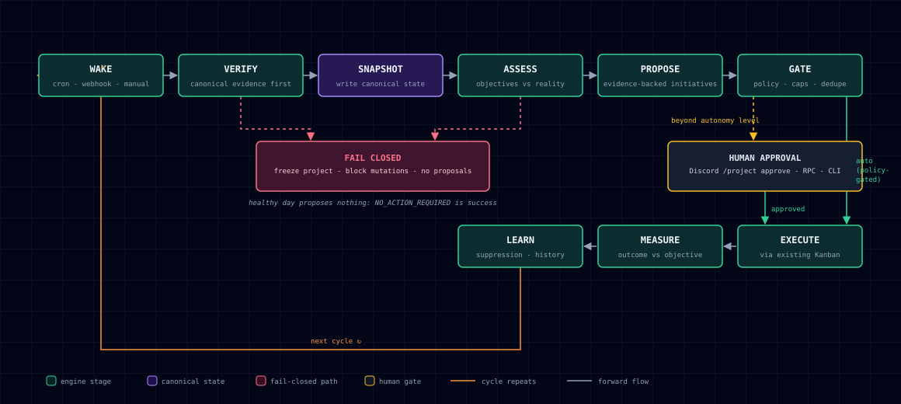
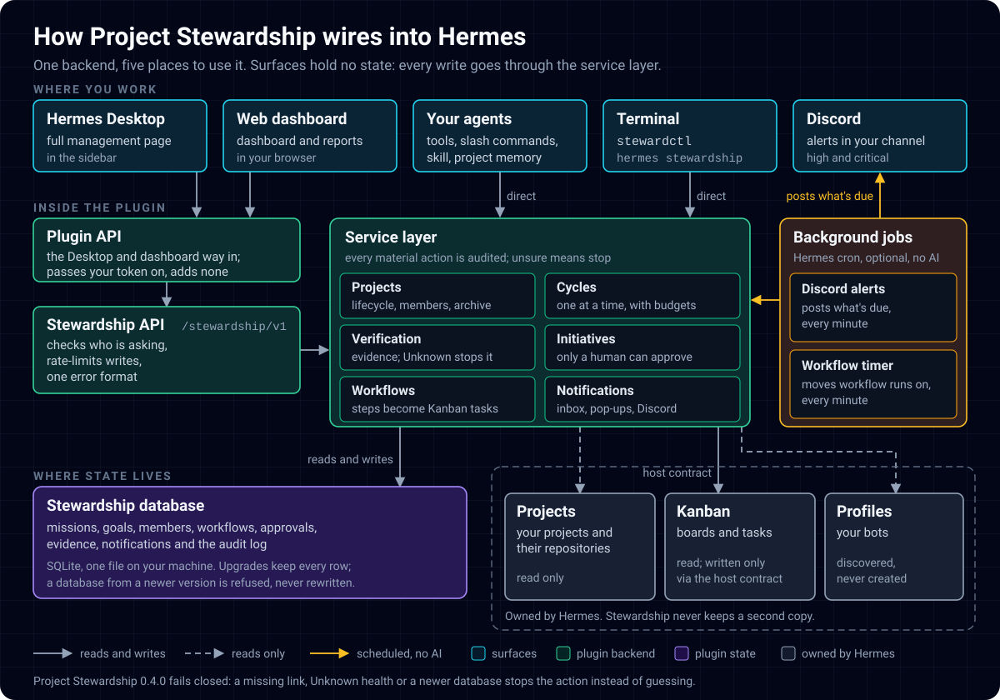

# Hermes Project Stewardship

Durable project **ownership** for Hermes agent fleets.

Hermes can complete tasks. Stewardship makes a team of Hermes profiles
**responsible for a project over time**: it verifies reality before acting,
turns gaps into evidence-backed initiatives, executes through existing Kanban,
enforces explicit autonomy policy, and measures whether the project actually
improved. CLI, RPC, dashboard and Desktop share one backend; authenticated
approval remains on RPC/dashboard and permission-bound gateway adapters.

> Status: **v0.3.0 local release candidate.** O1 complete work management
> and O2 initiative-to-observation delivery are implemented. Phases 0–5 of the
> project-management plan (`docs/plans/2026-09-10-project-management-stewardship.md`)
> are checkpointed. Phase 6 (surface, security and vanilla-compatibility
> hardening), Phase 7 (final regression, accessibility and visual proof) and
> Phase 8 (parent reconciliation, independent QA and merge) are **not complete**.
> The release is **not installed and not activated**; production rollout is not
> authorised. Run `hermes verify --json` for current test and readiness evidence
> on your own checkout, and read `docs/guides/canonical-ownership-and-surfaces.md`
> for what each surface does and does not support today.

---

## The ownership loop

Every stewardship cycle walks the same ring:

```
WAKE → VERIFY → SNAPSHOT → ASSESS → PROPOSE → GATE → EXECUTE → MEASURE → LEARN ↺
```

- **Verify first.** A cycle may not claim project status or authorise mutating
  work without canonical evidence (git state, tests/CI, declared files).
  Memory and session history are supporting evidence only.
- **Fail closed.** Unknown or contradictory project state blocks mutations.
- **Autonomy is restriction-only.** Project policy may narrow what Hermes may
  do; it never escalates tool permissions or credentials.
- **No busywork.** `NO_ACTION_REQUIRED` is a first-class cycle outcome.

## System workflow

The full cycle as it runs in the engine — including where human approval and
the fail-closed freeze sit:



## Architecture

Canonical Hermes Projects/Kanban owns projects, tasks, epics, hierarchy,
dependencies and execution state. Project Stewardship owns stewardship policy, evidence,
rankings, views, workflows, approvals and audit metadata in its SQLite WAL
store. Production work writes cross the versioned host adapter; there is no
legacy task dual-write path.

Ownership is one-way: Stewardship never becomes a second source of project
identity, work records or profile existence, and it never claims
cross-database atomicity between its own store and Hermes Kanban. The full
owner-by-owner table, the authority model, and what every surface supports at
this commit are in
[Canonical ownership and surface support](docs/guides/canonical-ownership-and-surfaces.md).



### Surfaces

| Surface | Entry point | Notes |
|---|---|---|
| Desktop plugin | host React wrapper + vanilla TypeScript, route `/dockyard` | Intended as the **complete** management surface; installed-app journey proof is still outstanding (Phase 7) |
| RPC API | `/stewardship/v1` | FastAPI optional extra; bearer auth + rate limiting; fails closed without a token |
| CLI | `stewardctl` (and `hermes stewardship`) | human output by default, `--json` on reads. Member / pending-transfer / project-archive recovery commands are Phase 6 work and are not present here |
| Dashboard plugin | `hermes_dockyard_plugin/dashboard` | Supported **subset** of the same backend contracts; the exact subset statement is Phase 6 work |
| Gateway commands | Discord et al. | permission binding + idempotent approvals. Read status/health/initiatives, approve/reject, run — no membership, archive or file-removal mutations |
| Model tools | `project-stewardship` toolset | `steward_status`, `steward_run_cycle`, `steward_propose_initiative`; approval is deliberately not a model tool |
| TUI | — | no stewardship TUI surface exists in this release |

## Autonomy levels

| Level | Name | Allowed by default |
|---|---|---|
| 0 | Assistant | Inspect and answer only |
| 1 | Investigator | Observe, research, non-mutating diagnostics |
| 2 | Planner | + create initiatives/plans (no source changes) |
| 3 | Builder | + branches, code, tests, PRs (gated: see security model) |
| 4 | Maintainer | + low-risk merges when policy gates pass |
| 5 | Steward | Broad lifecycle within release/budget policy |

Level ≥ 3 additionally requires the runtime capability allowlist gate
(`docs/threat-model.md` §6). Levels 4–5 ship disabled pending the merge-gate
implementation (`docs/prd-v0.2.md` §Deferred).

## Install

Requires Python 3.10+. No third-party runtime dependencies for the core engine.

```bash
git clone https://github.com/Sahil-SS9/hermes-project-stewardship.git
cd hermes-project-stewardship
uv sync --locked --extra dev --extra plugin
hermes verify --json         # bootstrap, full suite and readiness smoke
stewardctl --help            # standalone CLI
export STEWARD_RPC_TOKEN="$(python3 -c 'import secrets; print(secrets.token_urlsafe(32))')"
uvicorn --factory hermes_project_stewardship.api.server:create_app --host 127.0.0.1 --port 9310
```

### Vanilla Hermes plugin install

Install the repository as a Hermes directory plugin so its Python tools,
bundled skill, dashboard and Desktop assets stay together:

```bash
hermes plugins install Sahil-SS9/hermes-project-stewardship --enable
```

The plugin uses only shipped vanilla APIs: `register_tool`, `register_command`,
`register_cli_command`, `register_skill`, dashboard `manifest.json`/`router`,
and the Desktop plugin SDK. Canonical Projects/Kanban integration falls back
to the bundled vanilla adapter when `hermes_cli.project_kanban_host` is absent.

### Operational export and isolated restore

```bash
stewardctl --db ./stewardship.db export --output ./dockyard-export
stewardctl restore --archive ./dockyard-export --target ./restored.db
```

Exports use SQLite's online backup API and include a versioned manifest,
SHA-256 digest, byte size, schema version and integrity result. Restore refuses
existing targets, traversal, symlinks, checksum mismatches and invalid schemas.

The archive contains the Stewardship **database only**. Managed project content
lives outside it, at `<database parent>/project-content`, so a restore does not
bring managed files back — back that directory up separately. See
[Migration, backup and recovery prerequisites](docs/guides/migration-backup-recovery.md)
for the difference between database rollback, irreversible file removal and
backup restoration.

## 60-second example

```python
from pathlib import Path
from hermes_project_stewardship.persistence.store import Store
from hermes_project_stewardship.cycles.engine import CycleEngine

store = Store(Path("./stewardship.db"))
svc = store.services()

svc.enable(project_id="my-repo", mission="Keep CI >99% and deps fresh",
           lead_profile="lead", member_profiles=["coder", "qa"])
svc.add_objective("my-repo", name="ci-health", evaluator_type="command",
                  target=">=0.99", command=["pytest", "-q"], severity="high")

engine = CycleEngine(svc)
result = engine.run_cycle("my-repo")
print(result["health"]["state"])          # e.g. "healthy"
print([i["title"] for i in result["initiatives"]])
```

Then:

```bash
stewardctl health my-repo
stewardctl initiative list my-repo
stewardctl initiative approve INIT-0001
```

See [examples/example-project](examples/example-project) for a full walkthrough,
and [demo/](demo/) for a scripted 5-act terminal demo plus an interactive HTML
dashboard of the same story.

## Documentation

Ownership, lifecycle and operations

- [Canonical ownership and surface support](docs/guides/canonical-ownership-and-surfaces.md)
- [Lifecycle, archive/restore and managed-content removal](docs/guides/lifecycle-archive-restore.md)
- [Migration, backup and recovery prerequisites](docs/guides/migration-backup-recovery.md)
- [Shared runtime state and database selection](docs/RUNTIME-STATE.md)
- [Native task lifecycle semantics](docs/native-lifecycle-semantics.md)

Reference and history

- [PRD v0.2](docs/prd-v0.2.md) — product requirements this implementation satisfies
- [PRD v0.3](docs/dockyard-prd-v0.3.md) — current product requirements (canonical ownership correction in §3.4)
- [Authoritative implementation plan](docs/plans/2026-09-10-project-management-stewardship.md)
- [Architecture](docs/architecture.md)
- [Threat model](docs/threat-model.md)
- [Gateway command contract](docs/gateway-contract.md)
- [Roadmap to upstream Hermes core](docs/upstream-path.md)
- [API contract](docs/api.md)
- [Canonical roadmap](roadmap.md)
- [v0.2.0rc2 release packet](docs/release/0.2.0rc2-release-candidate.md)
- [v0.2.0rc1 historical release packet](docs/release/0.2.0rc1-release-candidate.md)

Phase 8 preparation (planning records — no merge, install or activation is implied)

- [Parent reconciliation plan](docs/release/0.3.0-phase8-reconciliation-plan.md)
- [Post-integration test and evidence checklist](docs/release/0.3.0-post-integration-test-checklist.md)
- [Independent review packet template](docs/release/0.3.0-phase8-independent-review-packet.md)
- [Deployment decision checklist](docs/release/0.3.0-deployment-decision-checklist.md)

## Security

Read [SECURITY.md](SECURITY.md) and [docs/threat-model.md](docs/threat-model.md)
before enabling autonomy above level 2 on any repository that accepts content
from untrusted people (issues, PRs, READMEs). Retrieved repository content is
untrusted input; it is never treated as authority over project policy.

## Licence

Apache-2.0. See [LICENSE](LICENSE).
