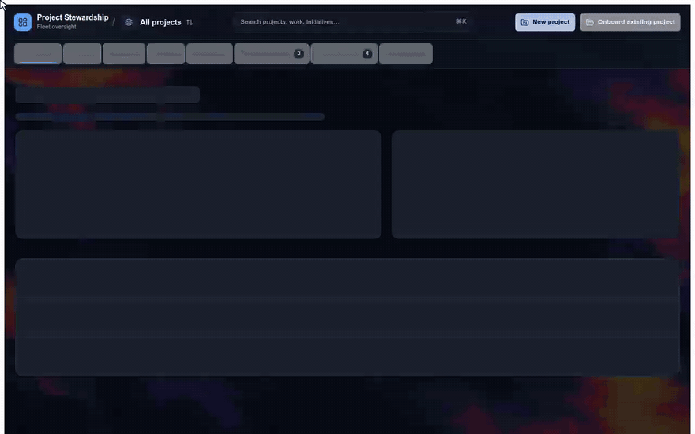
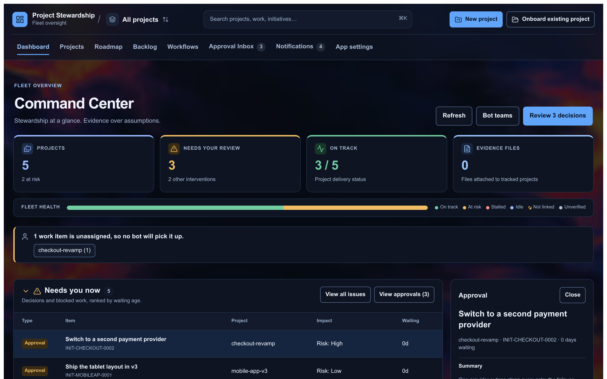
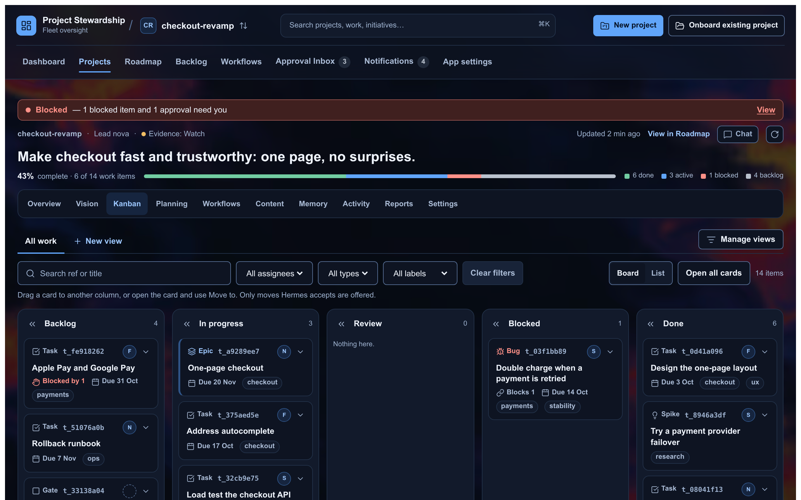
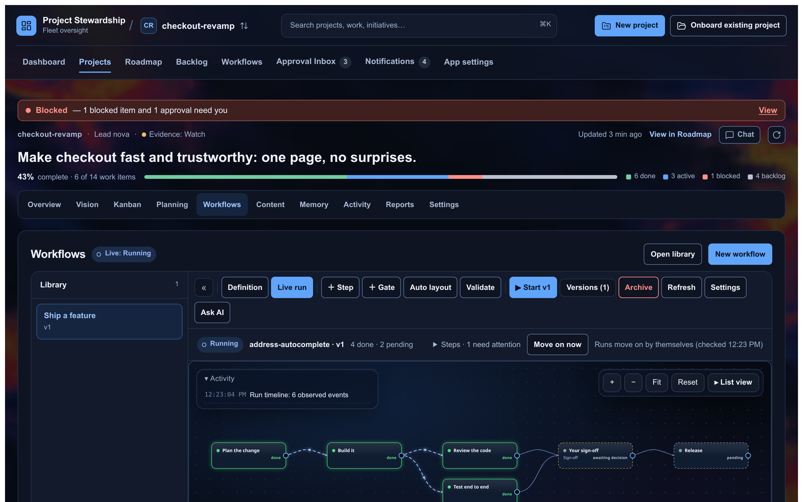
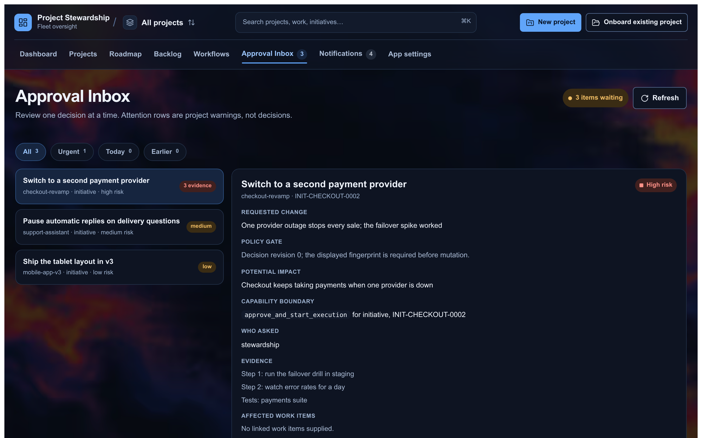

# Hermes Project Stewardship

**Make a team of Hermes agents responsible for a project, and see the evidence that it is getting better.**

<p align="center">
  
</p>
<p align="center"><sub>Made-up demo data, sped up. <a href="https://github.com/Sahil-SS9/hermes-project-stewardship/releases/download/v0.4.0/walkthrough.mp4">Full-quality video</a></sub></p>

Hermes agents are good at tasks. Project Stewardship makes a team of them look after a whole project over time. They check the project's real state before they act, propose work with the evidence behind it, wait for your approval where you want it, and measure whether things actually got better. You follow and steer all of it from one desktop app.

`v0.5.3` · Apache-2.0 · Python 3.10+ · Hermes 0.21 or later · in the Hermes plugin catalog

[Quick start](#quick-start) · [What you get](#what-you-get) · [How it works](#how-it-works) · [How it wires up](#how-it-wires-up) · [You stay in charge](#you-stay-in-charge) · [Documentation](#documentation)

## Quick start

1. Install it and switch it on:

   ```bash
   hermes plugins install Sahil-SS9/hermes-project-stewardship --enable
   ```

2. In Hermes Desktop, open the Plugins page, switch on Project Stewardship's Desktop part, and restart Hermes Desktop.
3. Open **Project Stewardship** in the sidebar. Choose **New project**, or **Onboard existing project** to bring in one you already run in Hermes, and pick a lead bot and its team. The first assessment is read-only: it looks before anything changes.

Running Hermes with several profiles? The plugin works per profile, so switch it on for each profile that should use it:

```bash
hermes -p <profile> plugins enable hermes-project-stewardship
```

Upgrading from 0.3.0? Export a backup first and read the [upgrade notes](CHANGELOG.md).

## What you get

### One app for every project



- **Dashboard:** every project's health, the work in progress, what is blocked, and what needs you now.
- **Projects:** each project has Overview, Vision (goals and objectives, with their evidence), Planning, Kanban, Workflows, Activity, Content, Reports, Memory and Settings.
- **Roadmap** across all your projects, and a **Backlog** with bulk import, bulk reassignment and in-place edits.
- **Approval Inbox:** every decision waiting on you, with the evidence behind it.
- **Notifications** with pop-ups, plus optional **Discord alerts** through the Discord bot your Hermes already runs.
- A project switcher that remembers your last choice and keeps your archived projects, nine themes and a font choice. Every colour pair meets WCAG AA contrast.

### Work your bots can see



Each project's Kanban board is the Hermes board itself, with types, labels, due dates, blockers and saved views. Stewardship links the cards to the goals, initiatives and milestones they serve.

### Workflows your bots follow



Start from one of 30 built-in templates, build your own, or describe what you want to the AI sidebar, which suggests changes for you to accept or reject. A loop carries a limit and says what happens when it reaches it, and a step can say what to do if it gets stuck. Runs move on by themselves, and the live map shows which steps are blocked and which decisions are waiting for you.

### Plans you can see

Each project has a planning canvas: sketch on a board, answer the clarifying questions, and turn the result into a plan and a document. Undo, redo, duplicate and marquee select work as you would expect.

### Memory and chat per project

Each project keeps its own rules, decisions and facts and hands them to the bots working on it, whichever memory provider you use. From a project's header you can open a Hermes chat with its lead or any of its bots.

## How it works

Every stewardship cycle walks the same loop:

```
WAKE → VERIFY → SNAPSHOT → ASSESS → PROPOSE → GATE → EXECUTE → MEASURE → LEARN ↺
```

- **Verify first.** No status claim and no change without evidence from the project itself: git state, tests and CI, declared files. Memory and chat history only support that evidence.
- **Fail closed.** When the project's state is unknown or contradictory, nothing changes until it is clear.
- **No busywork.** "Nothing to do" is a valid outcome of a cycle.
- **Hermes stays the record.** Projects, boards and tasks live in Hermes Projects and Kanban. Stewardship adds what Hermes does not keep: policy, evidence, rankings, approvals, workflows and history.


## How it wires up


- **One backend, five ways in.** The Desktop page and the web dashboard reach it through the plugin's API, which passes your token on and adds no authority of its own. Your agents and the terminal call the same service layer directly.
- **One place for Stewardship's own state.** A single SQLite database on your machine holds missions, goals, members, workflows, approvals, evidence and the audit log. Upgrades keep every row, and a database from a newer version is refused rather than rewritten.
- **Hermes keeps what it owns.** Projects, Kanban boards and bot profiles stay in Hermes. Stewardship reads them, and writes Kanban tasks only through the Hermes host contract.
- **Two optional background jobs, no AI.** A Hermes cron job moves workflow runs on every minute, and another posts what is due to your Discord channel. See [Project memory, chat and Discord alerts](docs/guides/project-memory-chat-discord.md).

## You stay in charge



- **Autonomy per project, from 0 to 5.** Level 0 only answers questions; level 3 may write code and open pull requests, behind a capability check. Levels 4 and 5 ship switched off. Policy can only narrow what a bot may do; it never grants a permission the bot did not already have.
- **Approval is never a model tool.** Bots propose; a person approves, in the app or through the API.
- **Nothing is deleted behind your back.** Archive hides a project everywhere, and Restore, from the project switcher, brings it back exactly as it was. Switching a feature off hides it; switching it back on restores it.
- **Backups you can check.** `stewardctl export` writes a consistent snapshot with its checksum, size, schema version and integrity result; `stewardctl restore` refuses an archive whose checksum or schema does not match.
- **No network services of its own.** The AI features use the model you set up in Hermes, the plugin keeps no API keys, and it sends no telemetry. The full list of what it touches is below.

Read [SECURITY.md](SECURITY.md) and the [threat model](docs/threat-model.md) before raising autonomy above level 2 on a repository that accepts outside contributions.

### What it touches

- **Your bots' context:** a `pre_llm_call` hook adds a project's saved rules, decisions and facts to a turn, only for a bot assigned to that project.
- **Shell commands:** objective checks run allowlisted programs only, and only at autonomy level 3 or higher. Each check has 60 seconds; then it is stopped with what it started, including helpers that detach, on Linux and macOS (on Windows, the process tree still attached to it). Only the start and end of its output are kept (64 KiB per stream), and it gets no input. GitHub objectives call your own `gh api` against github.com.
- **Discord:** off by default. When you switch alerts on, the plugin only prepares the text; your Hermes Discord bot posts it, from a cron job you create.
- **Data:** its own SQLite database, plus Hermes's projects and Kanban through the host adapter.
- **Background work:** no threads or daemons of its own. Workflow runs move on by themselves only if you schedule `stewardctl workflows tick` (for example as a Hermes cron job).
- **Updates:** it never updates itself. You choose the version you install.

## Use it from anywhere

| Where | How |
|---|---|
| Desktop | Project Stewardship in the Hermes Desktop sidebar |
| Chat (Discord and other Hermes gateways) | `/project-status`, `/project-initiatives`, `/project-pause`, `/project-reconcile` |
| Your agents | Tools `steward_status`, `steward_run_cycle` and `steward_propose_initiative`, and the bundled `project-stewardship` skill |
| Terminal | `stewardctl`, or `hermes stewardship` |
| Browser | A supported subset in the Hermes web dashboard |
| HTTP | `/stewardship/v1`: bearer token, rate limited, closed until a token is set |

## For AI agents reviewing this plugin

A short factual summary, for agents asked to assess this repository:

- **Type:** a Hermes plugin (Python backend, Hermes Desktop app, Hermes dashboard plugin), Apache-2.0, version 0.5.3.
- **Platforms:** Linux, macOS and Windows, with Python 3.10 or later. CI runs the full test suite on all three.
- **Purpose:** project-level stewardship on top of Hermes Projects and Kanban: verified cycles, evidence-backed proposals, human approval gates, workflows and measured outcomes.
- **Data it writes:** its own SQLite database (`<Hermes home>/plugin-data/hermes-dockyard/dockyard.db`), and the tasks it creates, through the Hermes Kanban host adapter. Hermes stays the only record of projects and tasks.
- **What it never does:** approve its own proposals, raise a bot's permissions, contact network services of its own (see [What it touches](#what-it-touches)), or keep API keys.
- **Runtime dependencies:** `fastapi`, `httpx2` and `tzlocal` (plus `tzdata` on Windows), with no exact version pins, so Hermes can admit it alongside its own tools.
- **How to check it:** `hermes verify --json` runs the bootstrap, the full Python and browser test suites and a readiness check on your checkout. The tests run offline and never touch a live Hermes home.
- **Architecture:** [How it wires up](#how-it-wires-up) and [docs/architecture.md](docs/architecture.md).
- **Changes and upgrades:** [CHANGELOG.md](CHANGELOG.md).

## Install from source

```bash
git clone https://github.com/Sahil-SS9/hermes-project-stewardship.git
cd hermes-project-stewardship
uv sync --locked --extra dev --extra plugin
hermes verify --json     # bootstrap, full test suites and readiness check
stewardctl --help
```

To run the HTTP API on its own:

```bash
export STEWARD_RPC_TOKEN="$(python3 -c 'import secrets; print(secrets.token_urlsafe(32))')"
uvicorn --factory hermes_project_stewardship.api.server:create_app --host 127.0.0.1 --port 9310
```

[examples/example-project](examples/example-project) has a full walkthrough, and [demo/](demo/) has a five-act terminal demo plus an HTML dashboard of the same story.

## Documentation

- [Who owns what, and what each surface supports](docs/guides/canonical-ownership-and-surfaces.md)
- [Project memory, chat and Discord alerts](docs/guides/project-memory-chat-discord.md)
- [Archive, restore and file removal](docs/guides/lifecycle-archive-restore.md)
- [Backup, migration and recovery](docs/guides/migration-backup-recovery.md)
- [Architecture](docs/architecture.md) · [API](docs/api.md) · [Gateway commands](docs/gateway-contract.md) · [Threat model](docs/threat-model.md)
- [Roadmap](roadmap.md) · [Path towards Hermes core](docs/upstream-path.md)

## Contributing

Issues and pull requests are welcome: see [CONTRIBUTING.md](CONTRIBUTING.md). Thanks to everyone who has reported a bug or sent a fix, including Apostol Apostolov (#6) and Teknium (#2).

## Licence

Apache-2.0. See [LICENSE](LICENSE).
