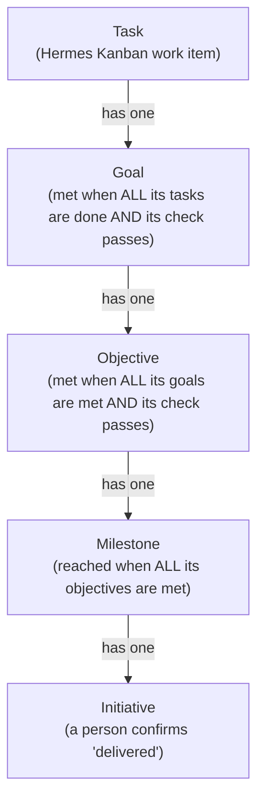
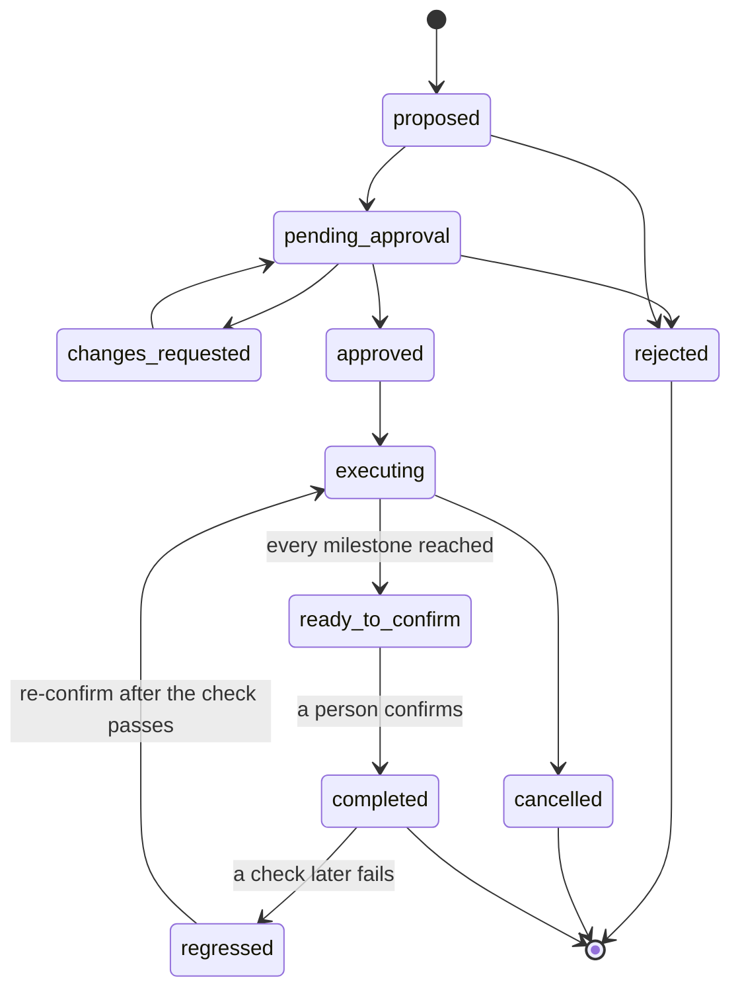

# Architecture


The picture above is the 0.4.0 wiring; the sections below give the rules behind it.

## One backend, many surfaces (non-negotiable)

```
            CLI (stewardctl)      RPC API (/stewardship/v1)     Gateway adapters
                   \                       |                        /
                    \                      v                       /
                     +------> StewardshipService <---- GatewayCommandHandler
                                        |                  (permission binding)
                                        v
                              CycleEngine (mutex, budget,
                              fail-closed gates)
                          /              |               \
             VerificationEngine   ObjectiveEvaluator   Initiative lifecycle
             (deterministic       (allowlisted argv)   (dedupe/caps/suppression/
              collectors +                              approval state machine)
              advisory tier)
                         \                |
                          +------ SQLite (WAL) -----+
                          canonical stewardship DB
```

There is no second state store anywhere. The Desktop panel is a thin React
client of the RPC; the gateway handler is a permission-checked wrapper around
the same service.

## Layers

| Layer | Module | Rules |
|---|---|---|
| Domain | `domain/` | pure; no IO. Policy engine is restriction-only by construction |
| Persistence | `persistence/` | only module touching SQL; numbered migrations; audit on every material action |
| Verification | `verification/` | deterministic collectors produce authority; advisory evidence flagged and never authoritative |
| Objectives | `objectives/` | strict target grammar; commands via allowlist runner only |
| Cycles | `cycles/` | orchestration + all global gates: mutex, idempotency, budget, pause/freeze, fail-closed |
| Security | `security/` | untrusted-content labelling/scanning; allowlisted execution; no business logic |
| Surfaces | `api/`, `cli/`, `gateway/` | translate transport ↔ service calls; zero SQL, zero policy |

## Fail-closed rules

1. Health Unknown or high-severity contradiction ⇒ no initiative proposals.
2. Paused project ⇒ gateway/cron/webhook cycles refused; manual allowed.
3. Frozen ⇒ everything refused until explicit resume.
4. Approval requires stored per-sender permission (gateway) or explicit actor
   attribution (CLI/RPC).
5. Level ≥ 3 autonomy requires BOTH untrusted-content acknowledgement AND
   runtime allowlist confirmation in verification policy — separate from the
   level model so it cannot be granted implicitly.

## Hermes integration contracts

The engine runs standalone (pure Python, stdlib-only). Integration with a
live Hermes runtime happens through four seams, each documented as a contract
rather than assumed:

1. **Plugin registration** (`plugin.py::register(runtime)`) — tools +
   slash-command group registered through whatever runtime handle upstream
   provides; defensive against missing surfaces.
2. **Scheduling** — cron/webhook triggers call `CycleEngine.run_cycle` with
   trigger_type + idempotency keys; dedupe/budget handled inside.
3. **Kanban bridge** — approved initiatives expose `bind_board(ref, slug)` +
   validation_contract; board creation uses the host's Kanban API at
   integration time. Initiative↔board linkage persists here either way.
4. **Desktop** — the dashboard extension mounts through vanilla Hermes
   dashboard plugin discovery (`dashboard/manifest.json` + `router`); the
   Desktop plugin uses the shipped `@hermes/plugin-sdk` contract.

## Storage

Companion SQLite DB keyed by **global project ID** (decision recorded from
concept-PRD §27.2). Rationale:

- avoids extending core `projects.db` during incubation;
- global keying prevents profile-scoped visibility bugs (upstream #75308);
- single-file WAL DB survives restarts; retention job keeps it bounded.

Migration to upstream core = moving this schema beside Projects' own tables;
the numbered-migration discipline makes that a mechanical translation.

## Testing shape

- Unit: policy invariant, health machine, evaluators, scanner, service rules.
- Integration: cycle engine end-to-end with real git repos under tmp_path.
- Regression: the six PRD scenarios (`tests/test_regression_scenarios.py`),
  plus mutex/idempotency/budget concurrency tests.
- Clock injection everywhere (`Store(clock=…)`) — no wall-clock tests.

## The delivery ladder

Since 0.5.0 the delivery model is a strict one-parent chain. Each item has at
most one parent at the next level up; a parent may have many children. An item
with no parent is allowed and shown as "Not placed yet". Both ends of a link are
always in the same project, and every placement write is audited in the same
transaction.



Roll-up is automatic up to the milestone; a person confirms the initiative. When
every milestone of an executing initiative is reached, the initiative shows
"Ready to confirm" and an Approval Inbox item appears. Confirming is refused
unless every milestone is reached. After completion, if any check in its ladder
later fails, the observation path marks the initiative `regressed`.



All states are derived at read time from stored links, task statuses and check
results. Nothing is stored as a percentage or a blended score, and unknown is
reported as unknown, never as met or as zero. On upgrade from 0.4.0, links that
map unambiguously are converted and everything else is listed under "Needs
placing" for a human to place by hand; the old link tables are kept as read-only
history so the downgrade restores 0.4.0 exactly.
